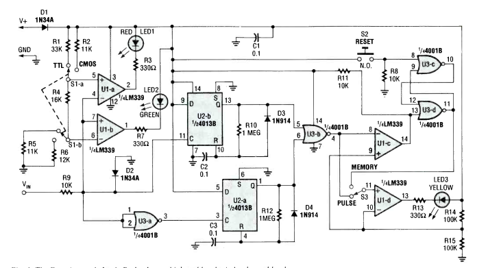

This project was developed in KiCad 10.0

The original circuit design was adapted from the below article.

Axelson, J. (1990). "Experimenter's Logic Probe."
*Electronic Experimenter's Handbook*, Popular Electronics.

